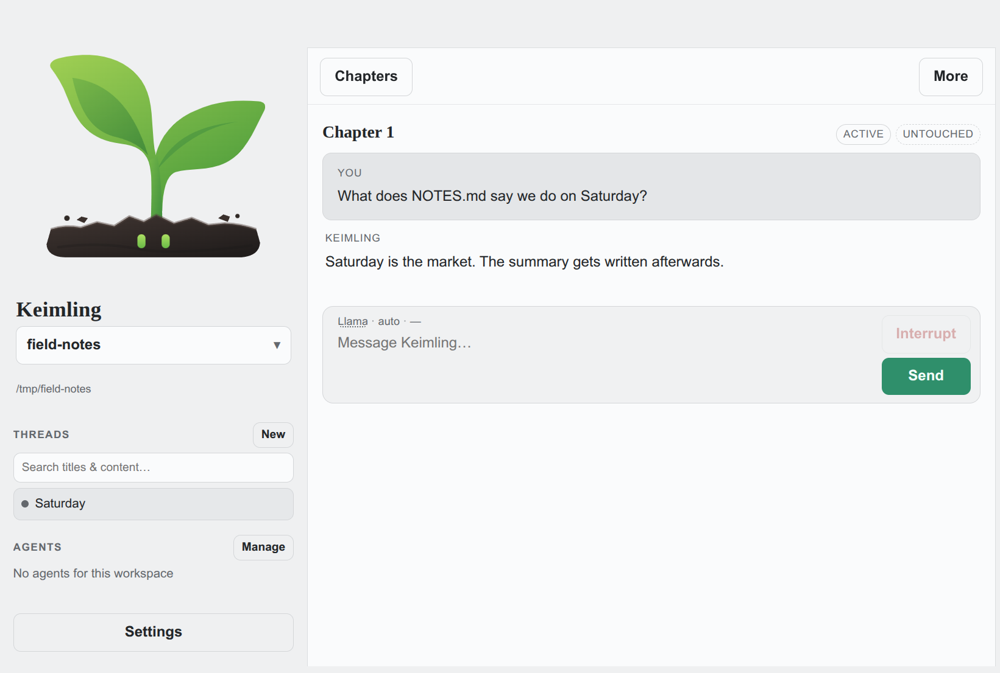
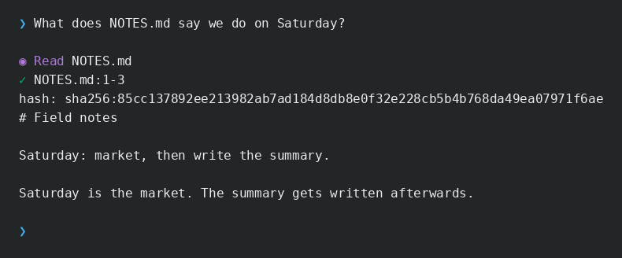
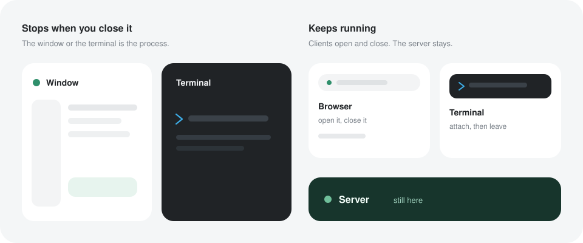

# Keimling

Keimling is a coding agent you run yourself. One small binary is the window, the terminal, and the server. It runs on Linux, macOS, and Windows.



The same agent in the terminal:



## Ways to run it



The window and the terminal are the agent. Close them and it stops.

```sh
./keimling
./keimling --cli
```

A server is the same agent, and it keeps running. A browser, or a terminal with `--connect`, attaches when you want to look or type. Closing that client leaves the server up.

```sh
./keimling --server --listen 127.0.0.1:7420 --access-secret …
./keimling --connect http://127.0.0.1:7420 --access-secret …
```

## The model is yours

The chat speaks the OpenAI Responses API. Point it at OpenAI, OpenRouter, or a local server such as llama.cpp. You can start with no provider and add one in Settings. Voice and web search are separate choices: they stay off until you pick a service, and that key is not sent to the chat provider.

## What it can use

The agent reads and edits files in the workspace and can run the shell. Skills, MCP servers, and plugins extend it. You can define agents and teams and talk to them from the chat. Previews open beside the conversation.

## Try it

Download a [release](https://github.com/arendtio/keimling/releases) for your OS, or build it. Building needs Go 1.26 or newer. The window uses the system web view: WebKitGTK 4.1 on Linux, WKWebView on macOS, WebView2 on Windows.

```sh
make
./keimling
```

## Limits

Keimling is experimental. It runs unsandboxed, with the permissions of the user who started it.

## Command-line options

Run `./keimling --help` for the generated list. Flags override the configuration file.

| Option | Default | Purpose |
| --- | --- | --- |
| `--version` | | Print the short git commit this binary was built from, then exit |
| `--ui` | off | Force native WebView UI (fail if unavailable) |
| `--cli` | off | Force shell client |
| `--server` | off | HTTP agent server only (UI + API; no interactive client) |
| `--listen` | none | Listen address for `--server` (required), e.g. `0.0.0.0:7420` |
| `--connect` | none | Attach the terminal to a running server (needs `--access-secret`) |
| `--access-secret` | none | Shared secret for the HTTP API (required with `--server`; or `KEIMLING_SECRET` / `KEIMLING_SECRET_FILE`) |
| `--public-url` | none | Public base URL for `share_file` links (e.g. `https://keimling.example.com`); else derived from `X-Forwarded-*` |
| `--mode` | `auto` | Approval mode: `ask`, `auto`, or `yolo` |
| `--model` | `gpt-6-luna` | Model for the main conversation |
| `--reasoning` | `high` | Reasoning effort: `low`, `medium`, `high`, `xhigh`, `max` |
| `--config` | `~/.config/keimling/config.json` (Windows: `%AppData%\keimling\config.json`) | JSON configuration file |
| `--api-key-file` | | Key file for the model provider |
| `--base-url` | | Responses-compatible endpoint, e.g. `http://localhost:8080/v1` |
| `--api-mode` | `responses` | Only `responses` is supported |
| `--web` | `true` | Allow web search when a search service is configured |
| `--check-model` | `true` | Validate the model against `/models` at startup |
| `--session` | workspace thread under the data directory | JSONL session file |
| `--resume` | `true` | Resume the last session |
| `--max-steps` | `200` | Maximum API rounds per user task |
| `--context-limit` | `128000` | Context token budget for compaction |
| `--compaction-model` | main model | Model used for context compaction |
| `--compact-parallel` | on | Parallel leaf distill/summarize (`false` for single local models) |
| `--review-model` | `gpt-6-luna` | Model for automatic approval review |
| `--approval-policy` | none | Path to additional approval policy text |
| `--autopilot` | `false` | Enable the autonomous task supervisor |
| `--autopilot-model` | `gpt-6-luna` | Supervisor model |
| `--autopilot-reasoning` | `high` | Supervisor reasoning effort |
| `--delegate-fast-model` | `gpt-6-luna` | Fast delegate model |
| `--delegate-balanced-model` | `gpt-6.1-sol` | Balanced delegate model |
| `--delegate-deep-model` | `gpt-6.1-sol` | Deep delegate model |
| `--voice-model` | `gpt-transcribe` | Transcription model |
| `--disable-external-services` | `false` | Disable web search and transcription |
| `--openai-api-key-file` | none | Separate OpenAI key file for web search and transcription when those services use OpenAI |

If the model cannot be found in the provider catalog, startup exits with status 2; other check failures only warn.

Threads and workspaces are stored under `~/.local/share/keimling/` on Linux and macOS. On Windows that data lives in the user cache directory. Configuration is `~/.config/keimling/config.json`, or `%AppData%\keimling\config.json` on Windows.

## Interactive commands

| Command | Purpose |
| --- | --- |
| `/help` | Show help |
| `/status` | Show model, context estimate, tokens, and settings |
| `/mode` | Show the current approval mode |
| `/mode ask\|auto\|yolo` | Switch approval mode |
| `/compact` | Run semantic context compaction now |
| `/compact <text>` | Compaction with extra guidance |
| `/newchat` | Archive the conversation and start fresh |
| `/stop` | Cancel current work without exiting |
| `/resume`, `/continue` | Resume an unfinished task |
| `/autopilot on\|off` | Enable or disable task supervision |
| `/voice` | Record audio; the transcript becomes an editable draft |
| `/exit`, `/quit` | Quit |

During a task, type a message to steer the next step. Key bindings: `Ctrl+G` toggles autopilot while typing, `F1`/space starts and stops recording on an empty prompt, arrow keys move the cursor and recall history, `Home`/`End` jump within the line, and `Tab` completes slash commands.

## Configuration file

Settings → Models writes the provider list. A provider is a name, a Responses base URL, a key, and the models you keep. `openai.key` is only for web search and transcription when those services use OpenAI, and is never sent to a custom chat provider. You can use `key_file` instead of an inline key. The file is mode `0600`. Anyone with the access secret may change it through the UI.

```json
{
  "model_providers": [
    {
      "id": "provider-local",
      "name": "local",
      "base_url": "http://127.0.0.1:8080/v1",
      "kind": "local",
      "model": "llama"
    }
  ],
  "active_model_provider_id": "provider-local"
}
```

## Build

The Go module lives in [`src/`](src). `make` builds `./keimling` in the repository root.

```sh
make            # build ./keimling
make test       # run the test suite
make check      # gofmt, go vet, and the tests
make clean      # remove the binary
```

`make build-nogui` builds the terminal and server binary without a web view. Without make: `cd src && go build -trimpath -o ../keimling .`.

GitHub Actions (`.github/workflows/gui.yml`) builds the windowed binaries for Linux, macOS, and Windows. Each binary is stamped with the short git commit; `keimling --version` prints it. A push to `main` publishes them as a GitHub Release under that commit.

A voice recorder is needed only for the microphone: `arecord` on Linux, `rec` (SoX) or `ffmpeg` on macOS, `ffmpeg` on Windows.

How it is put together is in [docs/](docs/README.md).

See [LICENSE](LICENSE) for licensing information.
